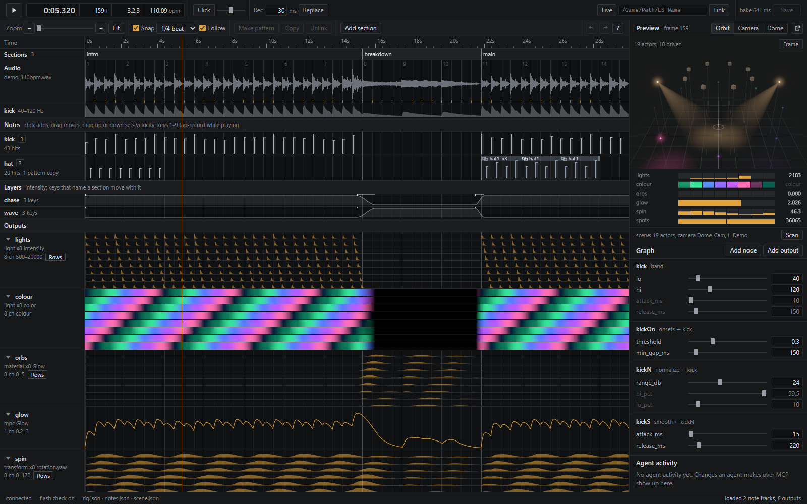
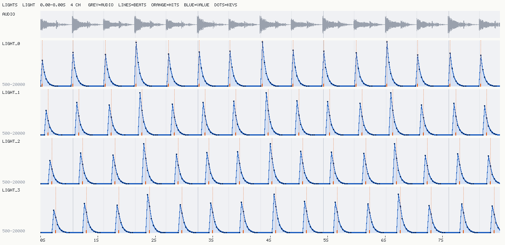
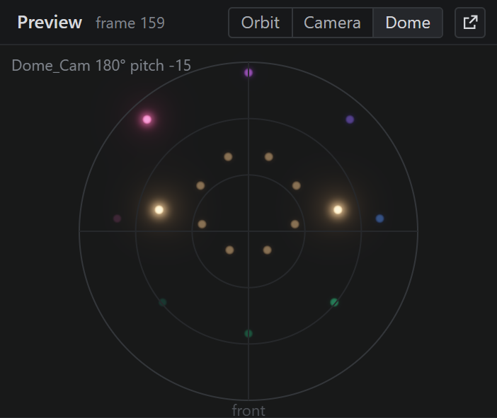

# beatrig

**A reactive engine for agents and artists: music in, deterministic animation keys out.**

beatrig analyses a song offline, runs it through a small JSON motion graph, and bakes the result into plain keyframes
(per-frame values plus a simplified set of linear keys) for lights, material parameters, material parameter collections,
Niagara parameters and transforms, in scalars or colour. The same inputs give a byte-identical bake (tested run to run on one machine), so a render matches the preview. Timing is
causal: nothing moves before its sound (ITU-R BT.1359), and continuous motion is eased, so only real hits snap. The output is
ordinary Sequencer keys, so nothing has to be installed at render time and there is no resolution cap. Every step can
be driven by an agent as well as by a person: there's a CLI, the files are hand-editable JSON, and an MCP server
covers the whole loop from analysing the song to writing keys into Unreal. With the live link on, an edit lands in
the Unreal viewport about a tenth of a second later.



## Three ways in

| | Use it for | Start here |
|---|---|---|
| **CLI** | scripting, CI, batch bakes | `beatrig analyze / notes / bake / check / serve` |
| **JSON files** | hand edits, version control, your own tools | `rig.json` (motion graph), `notes.json` (hit lanes), `bake.json` (output) |
| **MCP** | letting Claude Code or any MCP client drive it | `beatrig-mcp` (optional extra, below) |

All three work on the same files, and the preview page shows the result live. There is also a small Python API
(`load_rig`, `analyze`, `evaluate`, `bake`, `bake_from_objects`, `check`, `load_notes`, `save_notes`), described at
the end of the [ops reference](docs/ops.md#python-api).

## Quickstart

Python 3.10+ (CI runs 3.11 and 3.12 on Windows and Ubuntu).

```bash
git clone https://github.com/dexterlabs1/beatrig
cd beatrig
python -m venv .venv
. .venv/bin/activate              # Windows: .venv\Scripts\activate
pip install -e .                  # core: numpy, scipy, soundfile. Extras: [mcp], [stems] (Demucs + torch), [dev]

python examples/make_demo_audio.py                   # first: writes the demo audio (a synthetic 110 BPM loop)
beatrig analyze examples/ring-demo/rig.json          # tempo, beat grid, analysis cache
beatrig bake examples/ring-demo/rig.json             # writes examples/ring-demo/bake.json
beatrig serve examples/ring-demo/rig.json           # preview page on http://127.0.0.1:4700
```

`python -m beatrig ...` works the same as the `beatrig` command.

The ring demo drives eight lights with a kick-triggered chase, a material glow on eight orbs with a beat-locked wave,
and a global parameter-collection glow that follows the loudness. Two layers crossfade into the breakdown and back.

## Use it from Claude Code (or any MCP client)

```bash
pip install -e ".[mcp]"
claude mcp add beatrig -- beatrig-mcp
```

If `beatrig-mcp` isn't on the PATH Claude Code sees, give the full path to the script in your virtual environment
(`.venv/bin/beatrig-mcp`, or `.venv\Scripts\beatrig-mcp.exe` on Windows). Other clients take the usual stdio entry:
`{"mcpServers": {"beatrig": {"command": "beatrig-mcp"}}}`.

The server's tools ([full reference](docs/mcp.md)):

| Step | Tools |
|---|---|
| Hear the song (an agent can't listen) | `analyze` (tempo, beats, which frequency bands carry clear hits), `describe_audio` (per-bar energy per band, candidate section boundaries) |
| Build and tweak the rig | `list_ops`, `get_rig`, `add_node`, `set_node`, `remove_node`, `set_output`, `remove_output`, `set_layer`, `check` |
| Edit the hits | `notes_init` (from a band, onsets or the beat grid), `get_notes`, `notes_edit` (add / move / delete / velocity), `notes_snap` |
| Bake and look | `bake` (per-output stats and key counts), **`plot`** |
| Show the human | `preview_url`, `preview_start` |
| Write into Unreal | `ue_apply`, `ue_check`, `ue_undo` |

**`plot` is how the agent sees the animation.** It returns a PNG of one output's baked curves, drawn over the song's
waveform with the beat grid and every trigger hit marked (and the baked keys, when they are sparse enough
to read), one lane per channel, plus a small JSON caption.
A vision model can check timing, easing and the chase spread directly, without opening anything:



Every editing tool validates the whole rig before it writes (an invalid edit is refused and nothing changes), keeps a
`.bak` of the previous file, and returns a diff. Nodes, outputs and layers are addressed by id, hits by their time.
If the preview page is open, it is told about each change and reloads.

### Example session

This is an illustrative transcript, condensed, run against the ring demo. The numbers are from a real run; the
wording is an example.

> **You:** Make the ring of lights chase on the kick, and pull the lights back during the breakdown.
>
> **Agent** calls `analyze(rig_path="examples/ring-demo/rig.json")`
> → `bpm 110.01, 54 beats, suggested_bands ["bass", "kick", "presence"]`; the kick band (40-120 Hz) has 43 hits,
> 98% of them within 60 ms of a beat, contrast 26 dB.
>
> **Agent** calls `describe_audio(...)`
> → one row per bar; `candidate_boundaries` at 15.27 s (sub, kick, bass, mid, presence and air fall) and at 21.82 s
> (they all come back).
>
> **Agent:** The kick is clean and on the beat; there's a breakdown from about 15.3 s to 21.8 s. I'll make a kick lane.
>
> **Agent** calls `notes_init(track="kick", source="band:40-120", replace=true)` → `43 hits`, then `bake(...)` and
> `plot(output_id="lights", start_s=0, end_s=8, channels=[0, 1, 2, 3])`
>
> **Agent:** Each hit lands on the onset frame and the chase steps an eighth of a beat per light. The decay is
> slightly long for this tempo, so I'll shorten the envelope to 0.4 beats and check the plot again. The `chase` layer
> already fades to 0 over 30 frames at frame 450 (15.0 s), so the lights are down for the breakdown.
>
> **Agent** calls `set_node(node_id="pulse", params={"length_beats": 0.4})` → `diff {"length_beats": [0.5, 0.4]}`,
> `bake`, `plot` → then `ue_apply(bake_path="examples/ring-demo/bake.json", sequence_path="/Game/Show/LS_Ring")` and
> `ue_check(...)`.

## Concepts

A **rig** (`rig.json`) is a list of nodes, evaluated in dependency order, plus the outputs that send node signals to
targets.

- **Signals** are `float32[channels, frames]`, usually 0..1. A **trigger** is a signal that is non-zero only on hit
  frames, and its value is the hit's velocity. **Channels** let one node drive many targets: a `chase` turns one
  signal into eight delayed copies, `cycle` deals hits round a ring, `ripple` spreads a hit to its neighbours.
- **Nodes** are ops (39 of them): sources (`band`, `loudness`, `onsets`, `beats`, `notes`, `lfo`, `const`; bands and
  onsets can read a separated stem), shaping (`normalize`, `smooth`, `spring`, `curve`, `remap`, `threshold`,
  `envelope`, `delay`, `math`, `hold`, `accumulate`, `flash_limit`), per-hit flow (`push`, `shuffle_hits`, `every_n`,
  `probability`, `quantize`), channel ops (`fanout`, `chase`, `cycle`, `ripple`, `mirror`, `reverse`, `select`,
  `merge`, `shuffle`), colour (`gradient`, `palette_cycle`, `mix_color`, `scale_color`) and spatial ops that read real
  actor positions from a scene scan (`spatial_delay`, `dome_wave`, nearest-neighbour `ripple`).
- **Notes lanes** (`notes.json`) are editable hit timelines, one per track, in seconds of audio, so changing the frame
  rate never moves a hit. You fill one from detected onsets or the beat grid, then fix it by hand, on the page or by
  agent.
- **Layers** are eased intensity curves, keyed by frame or by song section. Put two outputs in two layers with
  opposite keys to switch looks between sections.
- **Patterns** are linked loops in a notes lane: edit the pattern and every copy follows.
- **Outputs** map a node to a target: a set of lights (`light`), a material parameter on actors (`material`), a
  material parameter collection (`mpc`), Niagara user parameters (`niagara`) or an additive transform channel
  (`transform`), scaled into `min`..`max`, or written as colour.
- **Safety**: a `safety` block makes `check` and `bake` refuse any light or emissive output that flashes more than
  three times in a second (the general-flash rule; a dome fills the whole field of view).
- **Bake** writes `bake.json`: for every output channel the per-frame values and a simplified set of linear keys
  (every trigger hit frame is kept).

A small rig:

```json
{
  "audio": "audio/song.wav",
  "fps": 30,
  "nodes": [
    { "id": "kick",  "op": "band", "lo": 40, "hi": 120 },
    { "id": "hits",  "op": "notes", "track": "kick" },
    { "id": "pulse", "op": "envelope", "in": "hits", "shape": "punch", "length_beats": 0.5 },
    { "id": "ring",  "op": "chase", "in": "pulse", "channels": 8, "step_beats": 0.125 }
  ],
  "outputs": [
    { "id": "lights", "signal": "ring", "min": 500, "max": 20000,
      "target": { "kind": "light", "property": "intensity",
                  "actors": ["Light_0", "Light_1", "Light_2", "Light_3", "Light_4", "Light_5", "Light_6", "Light_7"] } }
  ]
}
```

The rules every op follows (causal, eased, deterministic), every op's params and the Python API are in the
**[ops reference](docs/ops.md)**. The file formats (`rig.json`, `notes.json`, `bake.json`) and the reasoning behind
them are in the [design doc](docs/design.md).

## Unreal integration

`ue/beatrig_apply.py` runs inside the Unreal editor (UE 5.x, Python Editor Script Plugin) and writes a bake into a
Level Sequence:

| Target kind | What it writes |
|---|---|
| `mpc` | a Material Parameter Collection track on the sequence: a scalar or a vector (colour) parameter |
| `light` | a float track (`Intensity`) or a colour track (`LightColor`) on each actor's light component |
| `material` | a component material track on each actor's mesh: a scalar or a vector parameter |
| `niagara` | a Niagara float user-parameter track on each actor's Niagara component |
| `transform` | an additive 3D transform section: location, rotation or scale on one axis, on top of existing animation |

Every key is linear, so curves can't overshoot between keys. Every track it creates is named
`beatrig:<output id>[:<actor>]` and every binding it creates is tagged. `undo` removes exactly those tracks and
bindings and nothing else, and `apply` replaces only the tracks it wrote before, so re-applying is safe. The bake's fps must match the sequence's display rate; the applier
refuses rather than resample. Details, including the tick-time trap in parameter-collection keys:
[docs/unreal.md](docs/unreal.md).

Run it from the editor's console (Output Log, Cmd mode):

```
py "<repo>/ue/beatrig_apply.py" apply /Game/Show/LS_Main "<repo>/examples/ring-demo/bake.json"
```

or from an agent with `ue_apply`, which sends the same command to a running editor through the
**Remote Control** HTTP API (`PUT /remote/object/call` on `127.0.0.1:30010`, calling
`PythonScriptLibrary.ExecutePythonCommandEx`). Enable the Remote Control API and Python Editor Script plugins, then lock
Remote Control to this machine and allow that one function, in `Config/DefaultRemoteControl.ini`:

```ini
[/Script/RemoteControlCommon.RemoteControlSettings]
bAutoStartWebServer=True
bAutoStartWebSocketServer=False
RemoteControlHttpServerPort=30010
RemoteControlWebInterfaceBindAddress=127.0.0.1
bRestrictServerAccess=True
bAllowAnyRemoteFunctionCall=False
bEnableRemotePythonExecution=True
AllowlistedClients=((LowerBound=(ClassA=127,ClassB=0,ClassC=0,ClassD=1),UpperBound=(ClassA=127,ClassB=0,ClassC=0,ClassD=1)))
+CustomAllowedRemoteFunctionCalls=(ClassPath="/Script/PythonScriptPlugin.PythonScriptLibrary",FunctionName="ExecutePythonCommandEx",bAllowChildClasses=False)
```

and bind the HTTP server to localhost in `Config/DefaultEngine.ini`:

```ini
[HTTPServer.Listeners]
DefaultBindAddress=127.0.0.1
```

Restart the editor after changing either file. Anything that can reach this port can run Python in your editor, so
keep it on localhost.

### Live link

`beatrig.live.Link` keeps one Remote Control session open, imports the applier into the editor once, and pushes only the
outputs whose content changed. Measured on UE 5.8.3 with a three-output rig (6,000 keys): slider release to keys
evaluated in the editor took 104 ms median (re-bake 53 ms, push 49 ms). The preview page's Live toggle and the MCP
`live_push` tool use it. `playhead_get` / `playhead_set` keep the page and Sequencer on the same frame, and
`beatrig scan` (MCP `ue_scan`) reads the open level into `scene.json`: actors, positions, components, material
parameters, MPCs and the dome camera.

Keep live rigs short (a scene, not a whole show): writing keys costs about 16 microseconds per key in the editor.

The page's **Dome** view draws the scanned actors where they land on a domemaster from the scene's dome camera
(including its tilt), lit by their channels, so a `dome_wave` reads the way it will on the dome:



### Determinism, measured

Baked keys render the same every time. In-editor Movie Render Queue through an OWL 360 Domemaster pass rendered the
same 150 frames twice pixel-identically, and each light's rendered brightness matched its baked curve at zero frames
of lag. Starting the render at frame 75 instead of 0 matched the full run from its second frame. Animation computed
at runtime from tick time can't promise that.

## Status

v0.2.0. The test suite (102 tests) passes on Windows with Python 3.14; CI runs it on Ubuntu and Windows with Python
3.11 and 3.12. The CLI, preview page, MCP server and live link have been run by hand on Windows against UE 5.8.3.

| Part | Status |
|---|---|
| Analysis, ops, notes, layers, bake, `check` | Tested: pytest suite (determinism, causality, op maths, notes round-trip, key simplification); the ring demo bakes byte-identically run to run |
| CLI | Run by hand on the ring demo |
| Preview page | Checked by hand in a browser |
| MCP server | Run end to end over stdio with the MCP Python SDK client (list tools, analyze, describe_audio, rig and notes edits, bake, plot, preview notify); no automated test yet |
| `ue/keys.py` (tick maths, key planning, undo tags) | Tested: pytest |
| `ue/beatrig_apply.py` (the in-editor applier) | Tested live in UE 5.8.3 for every target kind (scalar, colour, transform, Niagara): apply, key-for-key `check`, re-apply in place, `undo` including bindings. Transform and colour values were read back off the actors at the playhead |
| Live link, scan, playhead sync | Tested live in UE 5.8.3; timings above. Unit tests run against a fake Remote Control server |
| `ue_apply` / `ue_check` / `ue_undo` / `ue_scan` / `live_push` over MCP | Run by hand against UE 5.8.3 |
| Niagara targets | Track, parameter name and keys verified; the value reaching a running system has not been checked (no template declares a user parameter) |
| Stems | Tested on CUDA (RTX 5090) and in unit tests; downloads the Demucs model on first use |
| 60-minute show | Measured: fresh analysis 28 s, 356 MB peak; bake 4.1 s |
| Linux | Test suite passes in CI; CLI, page and MCP server not tried by hand |
| macOS | Not tried yet |

## Roadmap

- Layouts: spawn and arrange actor rings and grids in the editor to match a rig's channels.
- Live input: MIDI and OSC triggers as note lanes.
- DMX output for real fixtures.
- Appliers for Blender and TouchDesigner.

## Troubleshooting

- **The preview port won't bind on Windows (`WinError 10013`).** Windows reserves some port ranges (Hyper-V, WSL,
  Docker). List them with `netsh int ipv4 show excludedportrange protocol=tcp` and pass a free port: `beatrig serve
  rig.json --port 4710`. The MCP server looks for the page at `BEATRIG_PREVIEW_URL` (default `http://127.0.0.1:4700`).
- **Every Unreal call takes about a third of a second.** The editor's "Use Less CPU when in Background" setting
  throttles it whenever it isn't the front window. The live link turns it off in memory for the session and restores
  it on close (about 11 ms per call instead of 330 ms). Don't save Editor Preferences while a link is open, or the
  "off" value is written to your ini.
- **`analyze` is slow the first time.** It builds the analysis cache (`analysis.json` + `analysis.npz` next to the
  rig). Later runs reuse it until the audio file or the analysis settings change.
- **An agent's edit didn't show on the page.** The page reloads from disk when it's told about a change, unless it has
  unsaved edits of its own (it says so in its agent strip). Save or discard them first.

## Contributing

See [CONTRIBUTING.md](CONTRIBUTING.md). Bug reports and pull requests are welcome.

## Licence

MIT. See [LICENSE](LICENSE).
